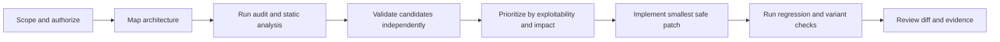

# Claude Security Skills Toolkit

<p align="center">
  <strong>Defensive security auditing, secure coding, vulnerability remediation, and patch validation for Claude Code.</strong>
</p>

<p align="center">
  <a href="https://github.com/cloudflare/security-audit-skill"></a>
  <a href="https://github.com/agamm/claude-code-owasp"></a>
  <a href="https://github.com/trailofbits/skills"></a>
  <a href="https://github.com/anthropics/claude-code-security-review"></a>
</p>

<p align="center"><em>Find the issue. Prove the issue. Patch it narrowly. Prove the fix.</em></p>

## What this repository provides

This is a curated, defensive toolkit for using Claude Code on web applications, APIs, services, and AI-enabled systems that you own or are explicitly authorized to assess.

It combines Cloudflare's `security-audit` workflow for reconnaissance, coverage-led hunting, independent validation, structured findings, and reports; OWASP-aligned secure coding guidance covering web vulnerabilities, ASVS 5.0, modern language pitfalls, supply-chain risks, and AI-agent security; targeted Trail of Bits plugins for analysis, triage, patching, and validation; and Anthropic's official `/security-review` reference. The reusable operating prompt is in [`PROMPT.md`](PROMPT.md).

## Recommended workflow



Start with [`PROMPT.md`](PROMPT.md), then use `security-audit` for a full audit, `owasp-security` during secure implementation, and Trail of Bits plugins when the task needs static analysis, differential review, variant hunting, or patch proof. Ask Claude to make changes only after findings are confirmed and the intended scope is explicit.

## Installation

From the extracted repository root in PowerShell:

```powershell
New-Item -ItemType Directory -Force "$HOME\.claude\skills" | Out-Null
Copy-Item -Recurse -Force .\skills\cloudflare-security-audit "$HOME\.claude\skills\cloudflare-security-audit"
Copy-Item -Recurse -Force .\skills\owasp-security "$HOME\.claude\skills\owasp-security"
```

Use the upstream Trail of Bits marketplace for selected plugins:

```text
/plugin marketplace add trailofbits/skills
/plugin install static-analysis@trailofbits
/plugin install differential-review@trailofbits
/plugin install patching-bugs@trailofbits
/plugin install post-patch-validation@trailofbits
```

The included plugin source also contains `audit-context-building`, `variant-analysis`, `insecure-defaults`, `sharp-edges`, `supply-chain-risk-auditor`, `fp-check`, and `code-improver` for review and selective use.

Claude Code also includes the official command:

```text
/security-review
```

See [`official-reference/action.yml`](official-reference/action.yml) for the GitHub Actions reference. Automated review complements manual review, tests, and established security controls.

## The master prompt

[`PROMPT.md`](PROMPT.md) instructs the agent to establish scope and threat model first, distinguish source review from authorized external testing, trace attacker-controlled input to a reachable security-sensitive sink, reduce false positives through independent validation, assign severity from demonstrated impact, produce minimal reviewable patches, and verify fixes with regression tests, variant analysis, and a clean diff.

## Safety boundary

Use this toolkit only on codebases, applications, and infrastructure you own or have written permission to assess. Do not probe third-party targets, bypass authentication, exfiltrate data, or run destructive tests.

Before enabling a skill, review its `SKILL.md`, scripts, and permissions. Use Claude Code Manual mode for sensitive repositories. Run target-controlled builds, tests, browsers, fuzzers, and fixtures inside an OS-enforced sandbox or dev container with restricted network access.

<details>
<summary><strong>Why the bundle is curated</strong></summary>

The repository favors defensive auditing and repair over offensive pentesting bundles. The selected workflows emphasize independent validation, false-positive reduction, scoped remediation, and proof that a patch closes the demonstrated path without introducing a regression.

</details>

<details>
<summary><strong>Repository contents</strong></summary>

`skills/cloudflare-security-audit/` contains the full audit workflow and validators. `skills/owasp-security/` contains OWASP and secure-coding references. `trailofbits-plugins/` contains selected audit, triage, patch, and validation plugins. `official-reference/` contains Anthropic command and GitHub Action references. `PROMPT.md` contains the reusable operating prompt.

</details>

## Sources and attribution

This repository preserves upstream source and licensing information where provided. The main sources are [Cloudflare security-audit-skill](https://github.com/cloudflare/security-audit-skill), [OWASP Security skill](https://github.com/agamm/claude-code-owasp), [Trail of Bits skills](https://github.com/trailofbits/skills), and [Anthropic Claude Code Security Review](https://github.com/anthropics/claude-code-security-review).

## License

Each upstream component retains its own license. Review the relevant license file in the component directory before redistribution or commercial use.
